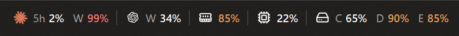
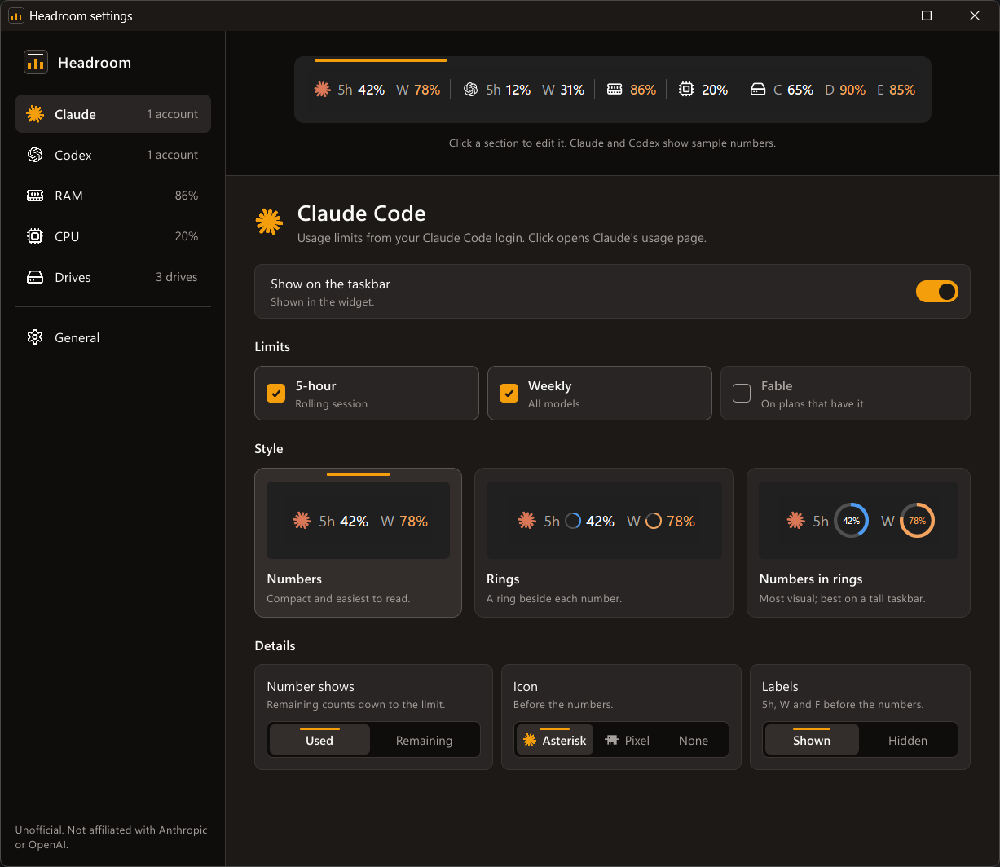

<div align="center">


# Headroom

**Know your limits before you hit them.**

A Windows 11 taskbar widget that shows your Claude Code and OpenAI Codex usage limits, plus RAM.

[](https://github.com/zaryabmustafa/headroom-widget/releases/latest)
[](https://github.com/zaryabmustafa/headroom-widget/releases)
[](https://github.com/zaryabmustafa/headroom-widget/actions/workflows/release.yml)
<br>


[](LICENSE)



**[Download](https://github.com/zaryabmustafa/headroom-widget/releases/latest)** ·
[Features](#features) ·
[Quick start](#quick-start) ·
[Usage](#usage) ·
[FAQ](#faq) ·
[Troubleshooting](#troubleshooting) ·
[Contributing](#contributing)

</div>

---

Headroom is a free, open-source usage tracker for Claude Code and Codex on Windows.
It sits in the taskbar next to the clock and shows how much of your Claude 5-hour
limit, Claude weekly limit and Codex (ChatGPT) rate limits you've used, so you can
see when you're close to a limit before you hit it.

## Features

- **Claude Code limits:** 5-hour and weekly usage, plus Fable if you turn it on.
- **Codex limits:** 5-hour and weekly usage from your Codex CLI login.
- **RAM and CPU:** memory in use and CPU load, updated every 2 seconds.
- **Drives:** space used on your internal drives.
- **Settings window:** each section has its own look (remaining or used, labels, icon, rings), with a live preview.
- **No API key:** reads the logins Claude Code and Codex already saved.
- **Several accounts:** add more Claude Code or Codex folders and see them side by side.
- **Light on your PC:** one native exe (Rust, Win32), about 18 MB of RAM and almost no CPU.
- **Easy to install and remove:** a small per-user installer or a single portable exe; no service, no admin rights, no telemetry.
- **Follows your theme:** light and dark taskbars, any DPI.

## Quick start

1. Sign in to [Claude Code](https://docs.anthropic.com/en/docs/claude-code) and/or the
   [Codex CLI](https://github.com/openai/codex) at least once.
2. Download `headroom-setup.exe` from the [latest release](https://github.com/zaryabmustafa/headroom-widget/releases/latest)
   and run it. It installs for your user only (no admin), adds a Start-menu shortcut,
   and can start Headroom when you sign in.
3. Headroom appears in the taskbar next to the clock.

Prefer no installer? Download `headroom.exe` instead, put it in a folder of your own and
run it. Right-click the widget, choose **Settings… → General** and turn on **Start with Windows** to launch it at sign-in.

Neither file is code-signed yet, so Windows SmartScreen may warn on first run:
choose **More info → Run anyway**.

## Usage

| Section | What you see | Click to open |
|---|---|---|
| **Claude Code** | `5h` and `W` (weekly) used %, plus `F` (Fable) if you turn it on | Claude's usage page |
| **Codex** | `5h` and `W` used % (plans with only a weekly limit show just `W`) | Codex's usage page |
| **RAM** | Memory in use, % | Task Manager |
| **CPU** | Load over the last 2 seconds, % | Task Manager |
| **Drives** | Space used on up to three internal drives, as % or size (used or free, e.g. `D 26.2 GB`) | This PC |

Hover for details: who's signed in, when each limit resets, used / total GB of RAM and
of each drive. Values turn orange above 75% and red above 95%, as in Claude Code.
Vertical taskbars (ExplorerPatcher, Windhawk, Windows 10) get a stacked layout.

### Menu

Right-click the widget:

| Item | What's inside |
|---|---|
| **Show** | Turn Claude, Codex, RAM, CPU or Drives on and off |
| **Accounts** | Add a Claude Code folder (`.claude`, `CLAUDE_CONFIG_DIR`) or a Codex folder (`.codex`, `CODEX_HOME`) · remove |
| **Settings…** | One page per section (limits or drives shown, remaining or used, labels, icon, usage rings) and General (font and icon size, update interval, accounts per column, rolling numbers, left side, Start with Windows) |
| | Refresh now · Open Claude / Codex usage page · Exit |

### Settings



The preview at the top is the widget as your taskbar will show it, and also the way in:
click a section to edit it, or a dimmed one to turn it back on. Each style choice is
drawn as the real thing, and every change applies to the taskbar straight away.

Settings live in `HKCU\Software\Headroom`.

## How it works

| Section | Reads | Asks |
|---|---|---|
| **Claude Code** | `%USERPROFILE%\.claude\.credentials.json` | `api.anthropic.com/api/oauth/usage`. Refreshes the login the same way Claude Code does |
| **Codex** | `%USERPROFILE%\.codex\auth.json` (or `CODEX_HOME`) | `chatgpt.com/backend-api/wham/usage`. Read-only: when the token has expired, it shows the last `rate_limits` event from `.codex\sessions`, dimmed |
| **RAM** | `GlobalMemoryStatusEx` | Nothing |
| **CPU** | `GetSystemTimes` | Nothing |
| **Drives** | `GetDiskFreeSpaceExW`, every 60 seconds | Nothing |

Each section fails on its own, so if one is down it shows `–` and the others carry on.

> Neither usage endpoint is a public API; either can change without notice.

### Privacy

Headroom only talks to `api.anthropic.com`, `platform.claude.com` and
`chatgpt.com`, using the logins that Claude Code and Codex already saved on
your PC. It has no telemetry and no self-update. It never writes to Codex's
`auth.json`.

## FAQ

**How do I check my Claude Code usage limit on Windows?**
Run Headroom. The Claude section shows the percentage of your 5-hour and weekly
limits used, and hovering shows when each one resets. Click it to open Claude's
usage page.

**Does it work with Claude Pro and Max plans?**
Yes. It works with any plan you sign in to Claude Code with; it shows the same
numbers as Claude Code's `/usage` command.

**How do I see my Codex rate limits?**
Sign in to the Codex CLI once. Headroom reads its saved login and shows the
5-hour and weekly Codex limits next to Claude's.

**Do I need an API key?**
No. Headroom uses the logins that Claude Code and Codex already saved on your PC.

**Will it get my account rate-limited?**
It checks at most once a minute (every 2 minutes by default), backs off when a
server says it's busy, and never retries a login the server refused.

**Does it work on Windows 10?**
It's built and tested on Windows 11. Windows 10 isn't tested.

## Troubleshooting

| You see | Do this |
|---|---|
| `–` in a section | Hover it for the reason. Usually the login has expired: run `claude` or `codex` once to sign in again |
| Codex numbers dimmed | The Codex login has expired, so Headroom is showing the last numbers from your Codex sessions. Run `codex` to refresh it |
| "Rate limited" on hover | The server asked Headroom to slow down. It backs off on its own; nothing to do |
| SmartScreen warning | The exe isn't signed yet. Choose **More info → Run anyway** |

Still stuck? [Open an issue](https://github.com/zaryabmustafa/headroom-widget/issues) with
what the tooltip says and your Windows version.

### Uninstall

**Installed with `headroom-setup.exe`:** Settings → Apps → Installed apps → Headroom →
**Uninstall**. It closes Headroom and removes the app, its shortcut, the sign-in entry
and its settings.

**Portable `headroom.exe`:** right-click the widget, turn off **Start with Windows** in **Settings… → General**, then
choose **Exit**. Delete `headroom.exe`, and optionally the `HKCU\Software\Headroom` registry key.

## Contributing

Bug reports and pull requests are welcome; see [CONTRIBUTING.md](CONTRIBUTING.md).
For anything bigger than a small fix, open an issue first so we can agree on the
approach. Report security problems privately as described in [SECURITY.md](SECURITY.md).

You need Rust (MSVC toolchain) and Visual Studio Build Tools with
**Desktop development with C++**.

```powershell
cargo build --release
cargo test
.\target\release\headroom.exe
```

Plans and decisions are in [docs/DEVPLAN.md](docs/DEVPLAN.md); releases are cut as
described in [docs/RELEASING.md](docs/RELEASING.md).

## Author and license

Headroom is made by [Zaryab Mustafa](https://github.com/zaryabmustafa).
It started as a fork of [claude-usage-widget-for-windows-taskbar](https://github.com/AbdoSarmini/claude-usage-widget-for-windows-taskbar)
by Abdo Sarmini and has since been largely rebuilt: Codex and RAM sections, the
redesigned widget and menu, multiple accounts, quieter networking, the installer
and the release pipeline.

MIT; see [LICENSE](LICENSE). The RAM, CPU and drive icons are Lucide's `memory-stick`,
`cpu` and `hard-drive` (ISC).

[](https://slint.dev)

The settings window is made with [Slint](https://slint.dev), under its royalty-free licence.

Unofficial: not affiliated with Anthropic or OpenAI. Claude and the OpenAI logo
are their owners' trademarks and are used only to label the sections.
Brand details are in [docs/BRAND.md](docs/BRAND.md).
