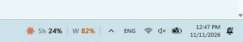
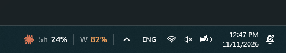
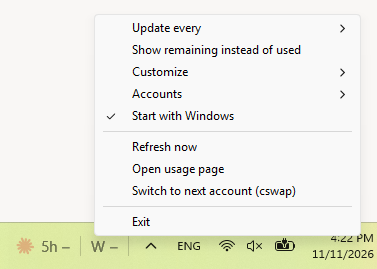

[
](https://github.com/AbdoSarmini/claude-usage-widget-for-windows-taskbar/releases/latest/download/ClaudeUsageWidget.exe)
# Claude Usage Widget For Windows Taskbar

See your Claude **5-hour** and **weekly** usage right on the Windows 11 taskbar, next to the clock.

<p>
  <br>
  
</p>

### ⬇️ [Download ClaudeUsageWidget.exe](https://github.com/AbdoSarmini/claude-usage-widget-for-windows-taskbar/releases/latest/download/ClaudeUsageWidget.exe)

One small file (~450 KB). No installer, nothing else to download.

## Features

- Always visible in the taskbar, not hidden in the tray.
- Tiny: about 5 MB of memory and near-zero CPU.
- Turns orange at 80% and red at 95%.
- Hover for reset times and details.
- Follows your light or dark Windows theme.
- Multiple Claude Code accounts at once.
- Customizable size, icon, labels and rings.
- Updates itself with one click (only when you ask).

## Requirements

- Windows 11.
- [Claude Code](https://code.claude.com/docs/en/setup) signed in with a Claude subscription (Pro, Max, Team or Enterprise). Run `claude` once and sign in; it doesn't need to stay open.

API keys and the Claude desktop app / claude.ai alone aren't supported.

## Install

1. Download the exe and put it somewhere permanent, e.g. `%LOCALAPPDATA%\Programs\ClaudeUsageWidget\`.
2. Double-click it. The widget appears left of the tray icons.
3. Right-click it and tick **Start with Windows**.

> **"Windows protected your PC"?** The exe isn't code-signed. Click **More info → Run anyway**, or [build it yourself](#build-from-source).

## Usage



- **Hover** for details, **left-click** to open your usage page on claude.ai.
- **Right-click** for everything else: update interval, show remaining instead of used, customize the look, add accounts, start with Windows, check for updates and exit.

### Multiple accounts

If you run Claude Code with another config folder (e.g. `CLAUDE_CONFIG_DIR=$HOME\.claude-work`), right-click → **Accounts → Add account…** and pick that folder. Each account gets its own row.

## Troubleshooting

| Problem | Fix |
|---|---|
| Numbers dimmed, tooltip says to sign in | Run `claude` and sign in again. |
| `–` instead of numbers | Check your internet, or hover for the error. |
| Widget overlaps app icons | Make it narrower under **Customize** (hide labels or icon, smaller font). |
| Not on my second monitor | Only the main taskbar is supported. |

## Privacy

Your usage is read from Anthropic (`api.anthropic.com`, `platform.claude.com`), the same servers Claude Code uses. Update checks go to GitHub. Your login stays on your PC. No analytics or telemetry.

## Uninstall

Untick **Start with Windows**, click **Exit**, and delete the exe. Settings live in `HKEY_CURRENT_USER\Software\ClaudeUsageWidget`.

## Build from source

Needs [Rust](https://rustup.rs/) (MSVC toolchain) and the Windows SDK.

```
git clone https://github.com/AbdoSarmini/claude-usage-widget-for-windows-taskbar
cd claude-usage-widget-for-windows-taskbar
cargo build --release
```

## Disclaimer

Unofficial community project, not affiliated with or endorsed by Anthropic. "Claude" is a trademark of Anthropic.

## License

[MIT](LICENSE)
